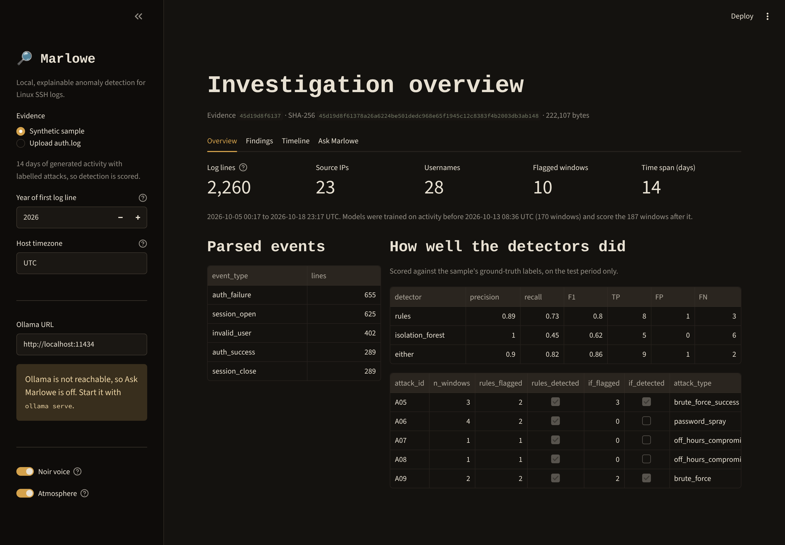
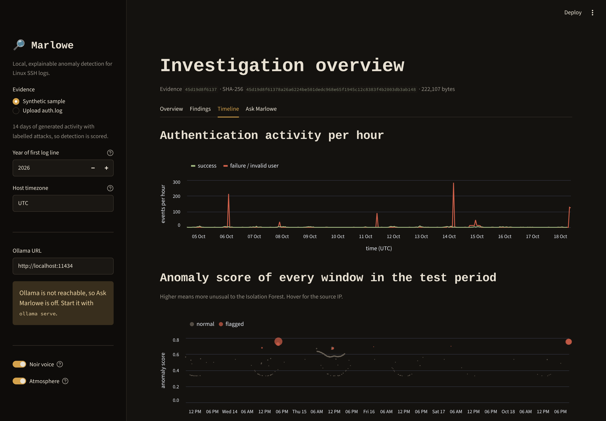

# Marlowe-DFIR

Marlowe-DFIR is a locally hosted, AI-assisted digital forensics and cybersecurity data science platform. It combines statistical analysis, machine learning and a local LLM to help an investigator analyse digital evidence, detect anomalies and understand patterns in data, with a focus on privacy, explainability and reproducible analysis.

> **Status:** early development. Evidence provenance and an end-to-end SSH `auth.log` anomaly-detection pipeline (parser, features, rule baseline, Isolation Forest, evaluation) are in place and tested, and a local LLM analyst (Ollama) can explain the findings using read-only tools, with every answer checked against the evidence. See [docs/roadmap.md](docs/roadmap.md).

## Design principle

**The LLM explains; deterministic code extracts, calculates and verifies.**
Every finding Marlowe reports should trace back to a computed result and the source records behind it. The local model never invents artefacts, timestamps or tool output.

## What works today

| Component | Status |
|---|---|
| Evidence registration: SHA-256 hashing, append-only provenance manifest, tamper verification | Done, tested |
| Synthetic labelled `auth.log` generator (attacks + realistic benign hard negatives) | Done, tested |
| Linux auth log parser: normalised UTC table, every line kept, line-level provenance | Done, tested |
| Per-IP, per-window feature engineering | Done, tested |
| Rule baseline and Isolation Forest, with explanations | Done, tested |
| Time-split evaluation: precision/recall/F1, average precision, incident-level detection | Done, tested |
| EDA and evaluation notebook | Done |
| Local LLM analyst via Ollama: read-only tools, line citations, grounding check, audit log | Done, tested; benchmarked on llama3.1:8b |
| Web app (Streamlit): overview, findings drill-down, timeline charts, chat with grounding badge | Done, tested headlessly |
| Noir persona (tone only, switchable) and noir theme | Done, tested; persona benchmark pending |

## Quick start

Requires Python 3.11+. The Python that ships with macOS is too old, so on a Mac run `brew install python@3.12` first and use `python3.12` below. If you paste these blocks into zsh (the macOS default shell), run `setopt interactivecomments` first so the `#` comment lines are ignored. From the repository root:

```bash
# create an isolated environment for this project
python3.12 -m venv .venv
# activate it (run this in every new terminal)
source .venv/bin/activate
# install Marlowe in editable mode, plus test/lint tools
pip install -e ".[dev]"
# run the test suite
pytest
# lint and formatting checks (same as CI)
ruff check . && ruff format --check .
```

### Run the analysis

```bash
# (re)create the synthetic log + labels (seed 42)
marlowe generate --out data/sample
marlowe analyse data/sample/auth.log --year 2026 --labels data/sample/auth_labels.csv
```

This registers the log as evidence, parses it, builds features, runs both detectors on the test period, prints the evaluation and writes every flagged window, with its source line numbers, to `data/processed/findings.csv`.

To open the notebook: `pip install -e ".[notebooks]"`, then `jupyter lab notebooks/`.

Headline result on the synthetic data: the rules catch 5 of 5 test-period incidents with 1 false positive, and the Isolation Forest reaches an average precision of 0.96 but is conservative at its pre-set threshold. See [docs/methodology.md](docs/methodology.md) for the full results, error analysis and limitations.

### Ask Marlowe (local LLM)

With [Ollama](https://ollama.com) running (see [docs/setup.md](docs/setup.md)):

```bash
ollama pull llama3.1:8b
marlowe chat data/sample/auth.log --year 2026 -q "What is the most serious finding?"
```

Marlowe can only see the evidence through read-only tools. It must cite `[line N]`, and a deterministic check verifies every citation, IP address and hash in its answer. See [docs/assistant.md](docs/assistant.md).

### Web app

```bash
pip install -e ".[web]"
marlowe web
```

Run it from the repository root so Streamlit picks up the noir theme in `.streamlit/config.toml` (edit the colours there; no Python needed). This opens `http://localhost:8501`, bound to this machine only. Pick the synthetic sample or upload an `auth.log`. The Overview, Findings and Timeline tabs work without Ollama; Ask Marlowe needs it running.



The Findings tab lists every flagged window with the reasons from both detectors, and shows the raw log lines behind any finding. `F1` in the table is the same `F1` Marlowe refers to in chat. The Timeline tab plots hourly authentication activity and the anomaly score of every window. Uploads are stored read-only under `data/raw/uploads/`, named by their hash, and registered in the evidence manifest like any other evidence.



Two switches in the sidebar: **Noir voice** has Marlowe answer like a 1930s Los Angeles private eye (in tone only: citations, IPs and counts stay exact and the grounding check is unchanged), and **Atmosphere** turns on a faint bank of smoke that drifts across the page about once a minute. While Marlowe works, a curl of smoke rises from a cigarette ember. Both animations are pure CSS, never block clicks, and switch off if your OS is set to reduce motion. On the command line, add `--noir` to `marlowe chat`.

### Use the library

```python
from marlowe.forensics import register_evidence, verify_evidence

record = register_evidence("data/raw/auth.log", "data/processed/case.manifest.jsonl")
print(record.evidence_id, record.sha256)
assert verify_evidence(record)  # False if the file has changed since registration
```

## Project layout

```text
src/marlowe/          Python package (application code)
  forensics/          hashing, provenance, evidence manifest
  synthetic/          labelled synthetic datasets
  parsers/            raw logs -> normalised tables
  features/           event -> window feature engineering
  detection/          rule baseline, Isolation Forest
  evaluation/         time split, metrics, incident detection
  assistant/          local LLM analyst: tools, Ollama client, agent loop, grounding check
  webapp/             Streamlit app (app.py lays out widgets; views.py shapes data, tested)
  pipeline.py         end-to-end analysis (used by the CLI, notebooks, assistant and web app)
  cli.py              `marlowe` command
tests/                pytest tests
notebooks/            exploratory analysis (not core logic)
data/raw/             local evidence, never committed
data/processed/       derived data, never committed
data/sample/          small, redistributable demo data only
docs/                 setup, architecture and roadmap
```

## Documentation

- [Setup, including local LLM install](docs/setup.md)
- [Architecture and design decisions](docs/architecture.md)
- [Methodology, results and limitations](docs/methodology.md)
- [The AI analyst: design, safety and model choice](docs/assistant.md)
- [Roadmap](docs/roadmap.md)

## Responsible use

Marlowe-DFIR is a research and portfolio project, not a certified forensic tool. Anomalies it flags are leads for an investigator to review, not proof of malicious activity. Use synthetic or public datasets for demonstrations, and never commit real evidence.
